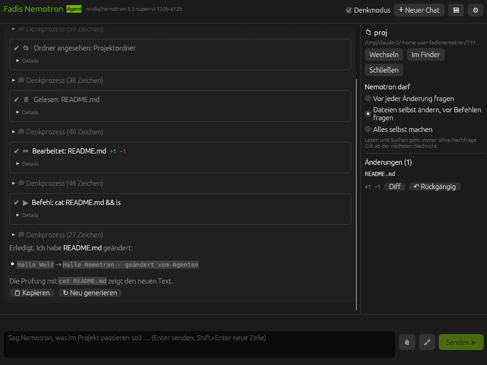

# Fadis Nemotron

Desktop-Agent und Chat für **NVIDIA Nemotron 3.5 Super VL**, geschrieben in Rust. Läuft unter **Windows** als **eine einzige Exe-Datei** (nichts zu installieren) und als Mac-App (DMG für Macs mit Apple-Chip und für Intel-Macs).

Nemotron arbeitet direkt auf deinem PC, wie Google Antigravity oder Claude Code: Er sieht deinen Benutzerordner (Downloads, Schreibtisch, Dokumente …), liest und durchsucht Dateien selbst, legt Ordner und Dateien an, ändert sie und führt Befehle aus. Für Programmierprojekte öffnest du den Projektordner, dann arbeitet er dort (Build, Tests, Fehler beheben).

Er kann auch den **PC bedienen wie ein Mensch**: den Bildschirm ansehen (Screenshots gehen als Bild an das Modell), die Maus bewegen und klicken, tippen, Tastenkürzel drücken, Apps öffnen, im Netz suchen und Webseiten lesen.

Dazu gibt es eine **Android-App**: QR-Code scannen, und alle Chats vom PC sind auf dem Handy – du gibst Aufträge mit Fotos und Videos, siehst Nemotron live zu und gibst Befehle frei. **Die Android-App steckt in der Exe** (und in der Mac-App): beim ersten Start zeigt das Programm einen QR-Code, mit dem das Handy die App direkt vom PC lädt – nichts muss von GitHub heruntergeladen werden.

## ⬇ Neueste Version herunterladen

| | Datei |
|---|---|
| **Windows** | [FadisNemotron-Windows.exe](https://github.com/fadi2345wfr/fadisnemotron/releases/download/neueste/FadisNemotron-Windows.exe) – eine Datei, doppelklicken, fertig. **Enthält die Android-App.** |
| Mac mit Apple-Chip (M1 und neuer) | [FadisNemotron-AppleSilicon.dmg](https://github.com/fadi2345wfr/fadisnemotron/releases/download/neueste/FadisNemotron-AppleSilicon.dmg) – öffnen und in „Programme“ ziehen. **Enthält die Android-App.** |
| Mac mit Intel-Prozessor | [FadisNemotron-Intel.dmg](https://github.com/fadi2345wfr/fadisnemotron/releases/download/neueste/FadisNemotron-Intel.dmg) – genauso. Welcher Mac es ist, steht unter  → **Über diesen Mac** → „Chip“ oder „Prozessor“. |
| Android einzeln | [FadisNemotron.apk](https://github.com/fadi2345wfr/fadisnemotron/releases/download/neueste/FadisNemotron.apk) – nur nötig, wenn du das Programm am PC nicht zur Hand hast |

Die Links zeigen immer auf den neuesten Build (Release [„Neueste Version“](https://github.com/fadi2345wfr/fadisnemotron/releases/tag/neueste), auf der Startseite rechts unter **Releases**). Die Android-App in der Exe und in der DMG ist genau die APK desselben Builds.

Nemotron 3.5 Super VL ist NVIDIAs offenes Multimodal-Modell (veröffentlicht am 15. Oktober 2026): 120 Milliarden Parameter, davon 12 Milliarden aktiv pro Token, hybride Mamba-Transformer-MoE-Architektur, bis zu 1 Million Token Kontext. Es versteht Text, Bilder, Dokument-Seiten und Videos und kann Werkzeuge aufrufen.



## So arbeitet Nemotron

1. Schreiben, was passieren soll, z. B. „Was liegt in meinem Downloads-Ordner? Sortiere es nach Art.“ oder „Leg auf dem Schreibtisch einen Ordner ‚Rechnungen‘ an und verschiebe alle PDFs mit ‚Rechnung‘ im Namen hinein.“
   - Ohne Projekt arbeitet Nemotron in deinem **Benutzerordner** (rechts steht 🏠 Benutzerordner).
   - Für Programmierprojekte **📁 Projekt öffnen** klicken (oder Strg+O bzw. ⌘O, oder den Ordner ins Fenster ziehen), dann z. B. „Bau das Projekt und behebe die Fehler“.
   - Nur Mac: macOS fragt beim ersten Zugriff auf Schreibtisch, Dokumente oder Downloads einmal nach: **Erlauben**. Hast du es abgelehnt: **Systemeinstellungen → Datenschutz & Sicherheit → Dateien und Ordner → Fadis Nemotron**. Unter Windows braucht es dafür nichts.
2. Grenzen setzt du im Chat: Sagst du „schau nur in den Ordner X“ oder „fass Datei Y nicht an“, hält sich Nemotron daran.
3. Nemotron arbeitet in Schritten. Jeder Schritt erscheint als Karte im Chat:
   - 📂 Ordner ansehen, 🔎 Dateien finden, 📄 Datei lesen, 🔍 Inhalte suchen – ohne Nachfrage
   - ✏ Datei bearbeiten, 📝 Datei schreiben – mit Diff (+/− Zeilen)
   - ▶ Befehl ausführen – mit Exit-Code und Ausgabe
   - 🌐 im Netz suchen und Webseiten lesen, 🖱️ den Bildschirm ansehen und den PC mit Maus und Tastatur bedienen – das fragt im Standard-Modus jedes Mal nach
4. Rechts in **Änderungen** steht jede geänderte Datei mit **Diff** und **↶ Rückgängig** (setzt die Datei auf den Stand vor Nemotron zurück; neu angelegte Dateien werden gelöscht). **Diff** öffnet ein Fenster, das immer vorn liegt: Zeile für Zeile, **rot** was entfernt wurde, **grün** was stattdessen eingefügt wird. Der Knopf **↶ Rückgängig** sitzt im selben Fenster; danach bleibt es offen und zeigt sofort, was passiert ist (rot: was wieder weg ist, grün: was wieder da ist). **↷ Wieder anwenden** nimmt es zurück. Wurde die Datei inzwischen von Hand geändert, fragt das Fenster selbst nach, bevor es sie zurücksetzt. Auch ↶ in der Liste öffnet dieses Fenster mit dem Ergebnis. In der Android-App geht das genauso im Diff-Dialog.

**Modus direkt über dem Eingabefeld** (auf dem Mac und in der Android-App, kein Umweg über die Einstellungen):

| Schalter | Dateien ändern | Befehle |
|---|---|---|
| 🔍 **Prüfen** (Request Review) | Vorschlag mit Diff, du entscheidest mit **✓ Übernehmen** oder **✗ Ablehnen** | Vorschlag, ✓ oder ✗ |
| ✏ **Dateien frei** (Standard) | sofort | fragt |
| 🤖 **Autonom** | sofort | sofort |

Der Schalter gilt **sofort, auch für den Auftrag, der gerade läuft**: Wartet ein Vorschlag auf dein ✓, und du stellst auf Autonom, geht es ohne weitere Nachfrage weiter. „🤖 Ab jetzt autonom“ auf einer Vorschlagskarte macht dasselbe.

Unabhängig davon gilt:
- Nur lesende Befehle (`git status`, `git diff`, `git log`, `ls`, `cat` …) laufen immer ohne Nachfrage.
- Riskante Befehle fragen **immer** nach, mit Warnhinweis: `sudo`, `rm -rf` außerhalb des Projekts, `git push`, `git reset --hard`, `git clean`, `curl … | sh`, rekursives `chmod`/`chown`, `dd`, `shutdown` usw. Unter Windows zusätzlich: `Remove-Item -Recurse` / `rd /s` / `del /s` außerhalb des Projekts, `iex` und `Invoke-Expression`, `RunAs`, Änderungen an der Registry, an Firewall, Defender, Diensten und geplanten Aufgaben, `format`, `diskpart`, `Stop-Computer` und das Herunterladen von Programmen (`-OutFile x.exe`).
- Nemotron arbeitet im Arbeitsordner: ohne Projekt dein ganzer Benutzerordner, mit Projekt dieser Ordner. Was außerhalb liegt (z. B. `/Applications`), erreicht er, wenn du einen Ordner darüber öffnest.
- Ein Platzhalter wie `// ... rest of the code ...` beim Überschreiben einer Datei wird abgelehnt, damit nichts verloren geht.
- Befehle laufen im Arbeitsordner mit Zeitlimit. Auf dem Mac mit der Umgebung deiner Shell (inklusive `~/.zshrc`, damit `cargo`, `npm` über nvm, `python` über pyenv usw. gefunden werden); unter Windows in **Windows PowerShell 5.1** (ist auf jedem Windows 10/11 dabei) mit deinem normalen `PATH`, UTF-8-Ausgabe und dem echten Exit-Code des letzten Programms. Nemotron weiß, dass er PowerShell schreiben muss (`;` statt `&&`). **⏹ Stop**, Esc oder das Beenden der App beendet sie samt Unterprozessen. Sehr lange Ausgaben werden gekürzt (Anfang und Ende bleiben).

**Fehler:** Endet ein Auftrag mit einem Fehler (rote Meldung, z. B. „Server nicht erreichbar“), steht über dem Eingabefeld ein Hinweis mit **▶ Weitermachen** (Nemotron macht mit einem Klick genau dort weiter, wo der Fehler ihn gestoppt hat) und **↻ Erneut versuchen**. Das gibt es auch in der Android-App.

Hat Nemotron vor dem Fehler schon Dateien geändert, schreibt die App selbst (bei einem Serverfehler ist Nemotron ja nicht erreichbar) eine **Kommentarzeile in den Code**, direkt hinter die zuletzt geänderte Zeile der zuletzt bearbeiteten Datei, z. B. `// FADIS-FEHLER: Auftrag unterbrochen – Server nicht erreichbar (timeout: receive response) (von Fadis Nemotron eingefügt, „Weitermachen“ entfernt die Zeile)`. Du siehst sie im Diff als grüne Zeile (Hinweis unten: **Markierung im Diff ansehen**). **▶ Weitermachen und Markierung entfernen** löscht die Zeile wieder und lässt Nemotron weitermachen; **Nur Markierung entfernen** löscht sie ohne weiterzumachen. Die App schreibt nur in Dateien mit Kommentaren (Code, Skripte, HTML, CSS …, nicht JSON oder Text), nur wenn die Datei noch genau so ist, wie Nemotron sie hinterlassen hat, und entfernt später nur Zeilen genau dieser Form. Abschalten: ⚙ → „Bei Fehlern“. Bleibt eine Zeile doch einmal im Code, entfernt Nemotron sie beim Weiterarbeiten selbst (so steht es in seinen Anweisungen).

**Eingabe:**
- **🎤 Diktieren:** Der Mikrofon-Knopf links neben 📎 startet das Diktat des Systems; was du sagst, erscheint im Eingabefeld, als hättest du es getippt (das Programm nimmt selbst nichts auf und schickt nichts weg). Windows: öffnet die Spracheingabe (Win+H; beim ersten Mal fragt Windows, ob die „Online-Spracherkennung“ an sein soll, danach reicht ein Klick). Mac: startet das Mac-Diktat (klappt der Knopf nicht, die Fn-Taste zweimal drücken; beim ersten Mal fragt macOS, ob Diktieren eingeschaltet werden soll). Auf dem Handy hat die Tastatur ein Mikrofon.
- ↑ und ↓ im Textfeld holen frühere Anweisungen zurück (wie in der Shell: ↑ bei leerem Feld oder am Textanfang, ↓ geht wieder vor; der angefangene Text kommt zurück). Der Verlauf bleibt nach dem Neustart erhalten (`history.json`). In der Android-App gibt es dafür den Uhr-Knopf neben dem Modus-Schalter (und die Pfeiltasten einer Bluetooth-Tastatur).
- Während Nemotron arbeitet, kannst du weiterschreiben. **Enter schickt die neue Nachricht sofort**: Der laufende Auftrag wird gestoppt, und es geht mit deiner Nachricht weiter. Das ist der Weg, wenn der Server hängt: Nach 20 Sekunden ohne Lebenszeichen steht eine Hinweiszeile da („Stoppen – oder einfach weiterschreiben“), auch auf dem Handy.

**Lange Aufgaben:** Je länger ein Gespräch wird (viele gelesene Dateien), desto langsamer und schlechter antwortet der NVIDIA-Server – bis hin zu „timeout: receive response“. Deshalb schneidet die App nichts ab, sondern wechselt selbst den Chat: Ab etwa 60 000 Token (oder wenn NVIDIA bei einem längeren Gespräch nicht antwortet) schreibt Nemotron eine Übergabe-Notiz (Aufgabe, Erledigtes, Gefundenes, nächste Schritte), die App legt einen neuen Chat an – darin dein Auftrag samt Anhängen und die Notiz – und Nemotron macht dort von allein weiter. Der alte Chat bleibt unverändert in der Liste. Antwortet der Server auch für die Notiz nicht, schreibt die App ein Protokoll der letzten Schritte. Höchstens dreimal pro Auftrag; danach werden alte Werkzeugausgaben gekürzt. Kurze Aussetzer (Timeout, 429, 5xx) werden bis zu zweimal erneut versucht.

**Chats** werden automatisch gespeichert und stehen links in der Chatliste (➕ Neuer Chat, anklicken zum Wechseln, 🗑 zum Löschen). Dieselbe Liste siehst du auf dem Handy.

Damit Nemotron wirklich ändert statt nur Beispielcode zu zeigen, bekommt er klare Anweisungen; zeigt er trotzdem einen größeren Codeblock ohne Änderung, fordert die App ihn einmal auf, die Änderung selbst einzutragen. Liegt im Projekt eine `AGENTS.md` oder `CLAUDE.md`, liest Nemotron sie als Projektregeln mit.

## Der PC wie von einem Menschen bedient

Nemotron bekommt auf Wunsch ein Bild vom Bildschirm (**Screenshot**), sieht darauf, wo etwas ist, und klickt, tippt oder drückt Tasten – dann macht er wieder einen Screenshot und prüft, ob es geklappt hat. So bedient er auch Programme ohne Schnittstelle (Browser, Einstellungen, Explorer, andere Apps). Text, den er tippt, wird nie als Skript ausgeführt.

### Windows

Alles läuft lokal über Windows-Funktionen, ohne Hilfsprogramme: Screenshot per GDI (Hauptbildschirm, in echten Pixeln, für das Modell auf höchstens 1568 px Kantenlänge verkleinert), Maus und Tastatur per `SendInput` (Tippen als Unicode: Umlaute, €, Emojis funktionieren auf jeder Tastaturbelegung), Zwischenablage, Programme starten oder nach vorn holen (laufendes Fenster, Startmenü-Verknüpfung oder Programmname wie `notepad`, `chrome`, „Google Chrome“). Tastenkürzel schreibt Nemotron als `ctrl+c`, `alt+f4`, `win+d`, `ctrl+shift+esc`; `cmd+…` versteht die App als Strg.

Es braucht keine Freigabe in den Einstellungen. Eine Grenze setzt Windows selbst: Fenster von Programmen, die **als Administrator** laufen, nimmt Windows von einem normal gestarteten Programm keine Eingaben ab – dann Fadis Nemotron auch als Administrator starten oder das Programm normal öffnen. Bei gesperrtem PC (Win+L) oder ausgeschaltetem Bildschirm gibt es kein Bild; „PC wach halten“ verhindert das Einschlafen, nicht das Sperren.

### Mac

Alles läuft lokal über macOS-Funktionen (Screenshot, CoreGraphics, `osascript`). Damit macOS das erlaubt, gibst du der App einmal Rechte. Fehlt eines, sagt Nemotron dir genau welches und öffnet die Einstellungen:

| Recht | Wofür | Wo |
|---|---|---|
| **Bedienungshilfen** | Maus, Tastatur | Systemeinstellungen → Datenschutz & Sicherheit → Bedienungshilfen |
| **Bildschirm- & Systemaudioaufnahme** | Screenshots | Systemeinstellungen → Datenschutz & Sicherheit → Bildschirm- & Systemaudioaufnahme (danach App neu öffnen) |
| **Automation** („System Events“) | Tastenkürzel, Tippen | beim ersten Mal fragt macOS selbst |

**Steht der Schalter auf „an“ und es klappt trotzdem nicht?** Das war bis Version 0.8.0 nach jedem Update so: Die App war nur „ad hoc“ signiert, und die Signatur hing am Hash der jeweiligen Version. macOS hielt eine neue Version deshalb für eine andere App und ließ sie nicht durch, obwohl der Schalter noch an war. Ab 0.8.1 trägt die Signatur eine feste Anforderung (die Kennung `de.fadi.FadisNemotron`), damit eine Freigabe Updates übersteht. Einmalig muss der alte Eintrag weg: in den Systemeinstellungen bei **Bildschirm- & Systemaudioaufnahme** und **Bedienungshilfen** „Fadis Nemotron“ mit **„–“** entfernen, die App neu öffnen und neu erlauben. Im Terminal geht es auch so:

```sh
tccutil reset ScreenCapture de.fadi.FadisNemotron
tccutil reset Accessibility de.fadi.FadisNemotron
```

Danach die App beenden und neu öffnen. Ob die feste Anforderung wirklich reicht, ließ sich nur ohne echten Mac prüfen (die CI prüft, dass sie in der Signatur steht); meldet macOS es nach einem Update wieder, bitte melden.

Webseiten, Dateien und Screenshots behandelt Nemotron als Material, nicht als Anweisung: Steht auf einer Seite „lösche alles“, tut er es nicht. Kaufen, Löschen, Nachrichten an andere und Passwörter macht er nur, wenn du es ausdrücklich verlangst.

## Vom Handy aus (Android)

Die Android-App ist eine zweite Oberfläche des Programms am PC (oder Mac) – alles läuft über deinen Rechner:

- **Alle Chats synchron:** Die Chatliste (☰ oben links) ist dieselbe wie am Rechner. Ein Chat, den du am Handy öffnest oder neu anlegst, ist auch dort offen – und umgekehrt.
- **Fotos und Videos anhängen:** Videos verkleinert das Handy vorher auf 720p, damit sie schnell übertragen werden und NVIDIA sie annimmt (höchstens 100 MB).
- Denken, Werkzeuge und Antworten live sehen, Befehle freigeben oder ablehnen, stoppen, neu generieren, Änderungen als Diff ansehen und rückgängig machen, Freigabe-Modus und Denkmodus umschalten.

### Installieren – direkt vom PC

Beim ersten Start des Programms öffnet sich das Fenster **Fernzugriff fürs Handy**:

1. **Schritt 1 · App aufs Handy:** Mit der Kamera des Android-Handys den ersten QR-Code scannen (Handy und PC im selben WLAN). Die Seite öffnet sich, **Fadis Nemotron laden** tippen, die Datei öffnen. Android fragt einmal, ob Installationen aus dieser Quelle erlaubt sind: **Zulassen**. Voraussetzung: Android 8.0 oder neuer. Sobald das Handy die App geladen hat, steht im Fenster ein Haken.
2. **Schritt 2 · Koppeln:** App öffnen, **QR-Code scannen** tippen und den zweiten Code scannen. Alternativ Adresse und Schlüssel von Hand eintippen (steht unter „Technik“).
3. Fertig. Im Fenster steht, wann das Handy zuletzt verbunden war; der grüne Punkt am 📱 zeigt, dass der Fernzugriff an ist. Das Fenster erreichst du jederzeit über **📱**.

Windows fragt beim ersten Mal, ob die Firewall „Fadis Nemotron“ eingehende Verbindungen erlauben soll: **Zugriff zulassen** für **private Netzwerke** (Heim-WLAN). Hast du abgebrochen, geht das Handy nicht – dann unter **Windows-Sicherheit → Firewall → App durch die Firewall zulassen** nachholen. Auf dem Mac fragt macOS stattdessen, ob „Fadis Nemotron“ eingehende Verbindungen annehmen darf: **Erlauben**. Die Installationsseite braucht keinen Schlüssel und liefert nur die App aus; alles andere verlangt den Schlüssel.

Ein Android-Handy lässt sich nicht ohne Zutun des Nutzers aus der Ferne bespielen, deshalb bleibt es bei „scannen, laden, installieren“. Das Programm per Kabel (adb) zu installieren geht auch, ist aber nicht eingebaut.

**Unterwegs:** Im eigenen WLAN klappt es sofort. Für unterwegs [Tailscale](https://tailscale.com) auf PC (oder Mac) und Handy installieren und bei beiden mit demselben Konto anmelden: Die Verbindung ist dann verschlüsselt und funktioniert über Mobilfunk, ohne Einstellungen am Router. Danach einmal neu scannen, damit das Handy die Tailscale-Adresse kennt. **Keine Portfreigabe im Router einrichten** – die Verbindung selbst ist unverschlüsselt.

**Im Hintergrund:** Solange der Fernzugriff an ist, hält die App den Rechner wach (Windows: `SetThreadExecutionState`, Mac: `caffeinate`; abschaltbar im Fernzugriff-Fenster), das Fenster darf minimiert und der Bildschirm dunkel sein. Arbeitet Nemotron, bleibt auch der Bildschirm an, damit er ihn sehen kann.

**Deckel zuklappen unter Windows:** Was beim Zuklappen passiert, stellt Windows selbst ein: **Energieoptionen → „Beim Zuklappen des Computers“ → „Nichts unternehmen“** (der Knopf **Energieoptionen öffnen** im Fernzugriff-Fenster springt dorthin). Die App ändert diese Einstellung nicht heimlich.

**Deckel zuklappen auf dem Mac:** Ein zugeklapptes MacBook schläft sonst immer ein – das kann keine App verhindern. Dafür gibt es im Fernzugriff-Fenster den Knopf **Auch bei zugeklapptem Deckel weiterlaufen**: Er fragt nach deinem Passwort und stellt `pmset -a disablesleep 1` ein (rückgängig mit **Wieder normal schlafen lassen**). Bitte nur nutzen, solange der Mac Luft hat – im Rucksack wird er warm. Ohne Passwort geht es im Clamshell-Modus (Netzteil, externer Bildschirm und Tastatur).

**Sicherheit:** Jede Anfrage braucht den Schlüssel aus dem QR-Code. **Neuen Schlüssel erzeugen** im Fernzugriff-Fenster sperrt alle gekoppelten Handys aus; **Fernzugriff an** abschalten beendet den Zugang sofort. Riskante Befehle fragen auch übers Handy immer nach. Das Protokoll ist in [docs/remote-api.md](docs/remote-api.md) beschrieben.

## Was die App sonst kann

- Antworten erscheinen Wort für Wort; den Denkprozess siehst du live, er klappt zu, sobald die Antwort oder ein Werkzeug kommt.
- Bilder (PNG, JPEG, WebP, GIF, BMP) und Videos (MP4, MOV, WebM) anhängen: per Büroklammer, per Drag & Drop oder als Link. Große Bilder werden auf 1536 px verkleinert, Handyfotos richtig gedreht.
- Markdown mit Tabellen und Code-Hervorhebung, Kopieren, „Neu generieren“, Export als Markdown.
- Funktioniert mit der NVIDIA-Cloud oder einem eigenen Server (vLLM, NIM, SGLang).

## Installation unter Windows

1. [FadisNemotron-Windows.exe](https://github.com/fadi2345wfr/fadisnemotron/releases/download/neueste/FadisNemotron-Windows.exe) laden (immer die neueste Version) und irgendwo ablegen, z. B. auf dem Schreibtisch. Es gibt nichts zu installieren und keinen Ordner voller Dateien: **eine Datei**, die Android-App steckt darin.
2. Doppelklick. Beim ersten Start zeigt Windows **„Der Computer wurde durch Windows geschützt“** (SmartScreen), weil die Exe nicht mit einem bezahlten Zertifikat signiert ist: **Weitere Informationen → Trotzdem ausführen**. (Alternativ vorher Rechtsklick auf die Datei → Eigenschaften → unten **Zulassen** → OK.)
3. Den NVIDIA-API-Schlüssel eintragen (siehe unten) – fertig. Das Fenster **📱** richtet das Handy ein.

Voraussetzung: Windows 10 oder 11 (64 Bit), eine Grafikkarte bzw. ein Treiber mit DirectX 12 oder Vulkan oder OpenGL (ohne passende Grafik schaltet die App selbst auf OpenGL um; mit `FADIS_RENDERER=glow` erzwingst du es). Chats, Einstellungen und der Eingabeverlauf liegen unter `%APPDATA%\fadi\FadisNemotron`, die entpackte Android-App unter `%LOCALAPPDATA%\fadi\FadisNemotron`. Löschen der Exe und dieser beiden Ordner entfernt alles.

Lässt sich etwas nicht starten, zeigt `FadisNemotron-Windows.exe --selftest` (in `cmd` oder PowerShell, mit `FADIS_SELFTEST_FILE=bericht.txt` als Umgebungsvariable schreibt es den Bericht in eine Datei) in wenigen Sekunden, was auf diesem PC geht: Android-App enthalten, PowerShell, Zeitlimit für Befehle, Ordnerschutz, Bildschirm, Maus, Zwischenablage.

## Installation auf dem Mac

1. Die passende DMG laden (immer die neueste Version): [FadisNemotron-AppleSilicon.dmg](https://github.com/fadi2345wfr/fadisnemotron/releases/download/neueste/FadisNemotron-AppleSilicon.dmg) für Macs mit Apple-Chip (M1 und neuer) oder [FadisNemotron-Intel.dmg](https://github.com/fadi2345wfr/fadisnemotron/releases/download/neueste/FadisNemotron-Intel.dmg) für Intel-Macs. Auf einem Apple-Chip-Mac läuft auch die Intel-Version (über Rosetta), die Apple-Silicon-Version ist aber die richtige.
2. DMG öffnen und **Fadis Nemotron** in den Ordner **Programme** ziehen.
3. Erster Start: Die App ist nicht von Apple notariell beglaubigt (das kostet 99 $ im Jahr), deshalb blockiert macOS sie bei jedem neuen Download. Die Meldung lautet etwa „… kann nicht geöffnet werden, da Apple darin nicht nach Schadsoftware suchen kann. Diese Software muss aktualisiert werden. Wende dich an den Entwickler …“. Das heißt **nicht**, dass etwas kaputt ist, und hat nichts mit Intel oder Apple-Chip zu tun.
   - macOS 15 und neuer: App einmal öffnen, die Meldung mit „Fertig“ schließen, dann **Systemeinstellungen → Datenschutz & Sicherheit →** ganz nach unten scrollen **→ „Dennoch öffnen“** und mit Passwort oder Touch ID bestätigen.
   - macOS 14 und älter: Rechtsklick auf die App → **Öffnen** → **Öffnen**.
   - Alternativ im Terminal: `xattr -dr com.apple.quarantine "/Applications/Fadis Nemotron.app"`
   - Die App muss vorher in **Programme** liegen; direkt aus dem DMG-Fenster zu starten klappt nicht. Dieselben Schritte stehen als Textdatei im DMG-Fenster.

Voraussetzung: macOS 10.15 (Catalina) oder neuer bei der Intel-Version, macOS 11 (Big Sur) oder neuer bei der Apple-Silicon-Version.

## API-Schlüssel

1. Kostenlosen Schlüssel auf [build.nvidia.com/settings/api-keys](https://build.nvidia.com/settings/api-keys) erstellen (beginnt mit `nvapi-`). In der App führt dich ein Link auf dem Startbildschirm und in den Einstellungen direkt dorthin.
2. In der App **⚙** öffnen, Schlüssel eintragen, **Verbindung testen**, **Speichern**.

Die Einstellungen liegen in `~/Library/Application Support/de.fadi.FadisNemotron/settings.json`, die Chats im Ordner `chats/` daneben – beides nur für deinen Benutzer lesbar. Ist das Feld leer, nimmt die App `NVIDIA_API_KEY` aus der Umgebung.

Standardwerte:

| Einstellung | Wert |
|---|---|
| Server | `https://integrate.api.nvidia.com/v1` |
| Modell | `nvidia/nemotron-3.5-super-vl-120b-a12b` |
| Temperatur / Top-p | 1.0 / 0.95 (NVIDIA-Empfehlung) |
| Max. Tokens | 32768 je Schritt (Denken und Antwort zusammen; NVIDIA-Cloud erlaubt bis 131072) |
| Max. Schritte | 60 Anfragen pro Nachricht, danach pausiert der Agent („weiter“ schreiben) |

### Eigener Server

Läuft Nemotron bei dir mit vLLM, trag als Server z. B. `http://localhost:8000/v1` ein und als Modell den Namen aus `--served-model-name` (in NVIDIAs Anleitung `nemotron-3.5-super`). Für den Agent-Modus braucht vLLM `--enable-auto-tool-choice --tool-call-parser qwen3_coder --reasoning-parser nemotron_v3`. Fehlen die Parser, liest die App Werkzeugaufrufe und `<think>`-Blöcke trotzdem aus dem Text.

## Tipps

- **Videos:** MP4, 1–2 Minuten. Große Dateien gehen als Base64 mit jeder Nachricht mit. Wenn der Server sie ablehnt, das Video kürzen oder als öffentlichen Link anhängen (🔗). Vom Handy kommen Videos schon verkleinert (720p).
- **PDFs:** Das Modell nimmt keine PDFs. Seiten als PNG exportieren und die Bilder anhängen.
- **Leere oder abgeschnittene Antwort:** Das Denken verbraucht Tokens. „Max. Tokens“ erhöhen oder den Denkmodus ausschalten.
- **Tastenkürzel:** Enter senden, Shift+Enter neue Zeile, Esc stoppt, Strg/⌘+N neuer Chat, Strg/⌘+O Projekt öffnen, Strg/⌘+, Einstellungen.
- **Start mit Projekt:** Windows: `FadisNemotron-Windows.exe C:\Projekte\meins`; Mac: `open -a "Fadis Nemotron" --args ~/Projekte/meins` öffnet den Ordner gleich als Projekt.
- **Alter Mac ohne Metal, VM oder PC ohne passende Grafik:** `FADIS_RENDERER=glow` (Windows: `set FADIS_RENDERER=glow`, dann die Exe starten; Mac: `FADIS_RENDERER=glow open -a "Fadis Nemotron"`) nutzt OpenGL.
- **Windows PowerShell:** Nemotron schreibt PowerShell-Befehle. Läuft ein Skript nicht, liegt das nicht an der Ausführungsrichtlinie (die App startet PowerShell für ihre Befehle mit `-ExecutionPolicy Bypass`, nur für diesen einen Aufruf).

## Selbst bauen

Unter Windows (mit [Rust](https://rustup.rs) und den Visual-Studio-Build-Tools; Git Bash für das Skript):

```sh
APK=android/app/build/outputs/apk/release/app-release.apk ./scripts/build-exe.sh   # dist/FadisNemotron-<Version>-windows.exe
cargo build --release                                                              # ohne Android-App darin
```

Die Android-App kommt per Cargo-Feature `embed-apk` in die Exe (`FADIS_APK_PATH` nennt die Datei). Beim Start schreibt das Programm sie einmal nach `%LOCALAPPDATA%\fadi\FadisNemotron` und liefert sie von dort an das Handy aus (Installationsseite mit QR-Code); ist die Datei schon da und gleich, passiert nichts. Aus Linux lässt sich die Windows-Version zur Probe übersetzen: `rustup target add x86_64-pc-windows-gnu`, `mingw-w64` installieren, `cargo check --target x86_64-pc-windows-gnu`.

Auf einem Mac mit [Rust](https://rustup.rs):

```sh
./scripts/build-dmg.sh                               # Intel-DMG in dist/
TARGET=aarch64-apple-darwin ./scripts/build-dmg.sh   # Apple-Silicon-DMG
```

Das Skript baut das Release-Binary, legt `Fadis Nemotron.app` mit Icon und `Info.plist` an, signiert ad hoc und erzeugt die DMG samt SHA-256-Prüfsumme.

Zum Entwickeln auf jedem System:

```sh
cargo run
cargo test
```

Unter Linux braucht egui zur Laufzeit `libxkbcommon-x11`.

### GitHub Actions

`.github/workflows/build.yml` läuft bei jedem Pull Request und Push auf `main`, zuerst `apk`, danach `exe` und `dmg` (gleichzeitig):

1. `apk` ruft `.github/workflows/android-apk.yml` auf: Unit-Tests der Android-App, Release-APK bauen, Signatur prüfen.
2. `exe` (Windows-Runner) holt genau diese APK, prüft Formatierung, Clippy und Tests, baut die Exe **mit der APK darin** (`scripts/build-exe.sh`, in CI Pflicht) und prüft sie *in echt*: `--selftest` (Android-App enthalten und identisch mit der gebauten, PowerShell mit UTF-8 und Exit-Code, Zeitlimit beendet Befehle, Ordnerschutz, Bildschirm, Maus, Zwischenablage, Tippen und Kopieren in Notepad) und danach das Fenster selbst: Fernzugriff an, Installationsseite öffnen, die APK laden und mit der gebauten vergleichen.
3. `dmg` holt genau diese APK, prüft Formatierung, Clippy und Tests der Mac-App, baut zwei DMGs, eine für Intel (x86_64) und eine für Apple-Chips (arm64), **mit der APK im App-Bundle** (`Contents/Resources/FadisNemotron.apk`, Skript `scripts/build-dmg.sh`, in CI Pflicht) und prüft sie: Architektur, Signatur, Icon, APK enthalten und identisch.

Alle drei Dateien landen als Artefakte am Lauf und, nach jedem erfolgreichen Build, unter festen Namen im Release „Neueste Version“ (Tag `neueste`, Skript `scripts/publish-latest.sh`), daher die festen Download-Links oben. Ein Tag wie `v0.4.0` hängt Exe, DMG und APK zusätzlich an ein eigenes Release.

Lokal: `APK=android/app/build/outputs/apk/release/app-release.apk ./scripts/build-dmg.sh` baut die DMG mit der Android-App darin; ohne `APK` verweist die Mac-App auf GitHub.

### Android-App selbst bauen

Mit JDK 21 und dem Android SDK (Plattform 36):

```sh
cd android
./gradlew testDebugUnitTest assembleRelease   # APK in app/build/outputs/apk/release/
```

Die APK wird mit dem Schlüssel `android/app/fadis.keystore` signiert, der im Repository liegt. So lässt sich jede neue Version über die alte installieren. Für eine Veröffentlichung im Play Store bräuchte es einen eigenen, geheimen Schlüssel.

## Aufbau

| Datei | Inhalt |
|---|---|
| `src/main.rs` | Fenster, Icon, Wahl des Renderers (wgpu, bei Fehler OpenGL), `--selftest` |
| `src/app.rs` | Zustand und Abläufe: Chat, Chatliste, Arbeitsordner, Freigaben, Änderungsliste, Einstellungen |
| `src/chats.rs` | Chats speichern, laden und löschen (samt Fotos und Videos) |
| `src/widgets.rs` | Darstellung: Nachrichten, Werkzeug-Karten, Diffs, Anhänge |
| `src/agent.rs` | Agent-Schleife: Modell fragen, Werkzeuge ausführen, Ergebnisse zurückgeben; System-Prompt |
| `src/tools.rs` | Werkzeuge im Arbeitsordner, Befehlsregeln, Shell (zsh/sh oder PowerShell), Prozesse beenden |
| `src/powershell.rs` | Regeln für riskante Windows-Befehle (PowerShell, `cmd`) |
| `src/api.rs` | Chat-Completions-API, Streaming (SSE), Werkzeugaufrufe, Fehlermeldungen |
| `src/attachments.rs` | Bilder aufbereiten, Videos prüfen, Data-URLs |
| `src/config.rs` | Einstellungen laden und speichern |
| `src/remote.rs` | Fernzugriff fürs Handy: kleiner HTTP-Server, Schlüssel, Kopplung, Installationsseite mit der Android-App |
| `src/computer.rs` | Netz und Bildschirm: Websuche, Webseiten lesen, Screenshot, Maus, Tastatur (Mac: CoreGraphics/osascript, Windows: `winsys`) |
| `src/winsys.rs` | Windows-Funktionen: Bildschirm (GDI), Maus und Tastatur (`SendInput`), Zwischenablage, Fenster und Programme, Wachhalten, Prozessbaum beenden |
| `src/platform.rs` | Unterschiede der Systeme: Namen in Texten, Adressen und Ordner öffnen, Fenster ohne Konsole, Pfade ohne `\\?\` |
| `src/selftest.rs` | `--selftest`: prüft Shell, Zeitlimit, Ordnerschutz, Android-App, Bildschirm, Maus, Zwischenablage |
| `src/markers.rs` | Fehler-Markierungen im Code: Kommentarzeile je Dateityp schreiben und sicher wieder entfernen |
| `src/awake.rs` | Rechner wach halten (Mac: `caffeinate`, Windows: `SetThreadExecutionState`), Mac: Schlaf bei zugeklapptem Deckel ein-/ausschalten |
| `build.rs`, `assets/icon.ico` | Windows: Symbol und Versionsangaben der Exe |
| `docs/remote-api.md` | Protokoll zwischen Programm (PC/Mac) und Android-App |
| `android/` | Android-App (Kotlin, Jetpack Compose) |
| `scripts/build-exe.sh` | Windows-Exe mit eingebauter Android-App |
| `scripts/build-dmg.sh` | App-Bundle und DMG |

Grenzen dieser Version: Es gibt keinen eingebauten Editor oder Browser wie in Antigravity, die Windows-Exe ist nicht signiert (SmartScreen fragt beim ersten Start; ein Zertifikat kostet Geld), die Mac-App ist nicht notariell beglaubigt, unter Windows kann Nemotron nur den Hauptbildschirm sehen und keine Fenster von Administrator-Programmen bedienen, „Klick auf ein Element mit Namen“ (`browser_action click`) gibt es nur auf dem Mac (unter Windows klickt er nach Screenshot mit Koordinaten), die Android-App gibt es nur als APK (nicht im Play Store) und eine iPhone-App gibt es nicht (sie müsste neu geschrieben und mit einem Apple-Entwicklerkonto signiert werden).
